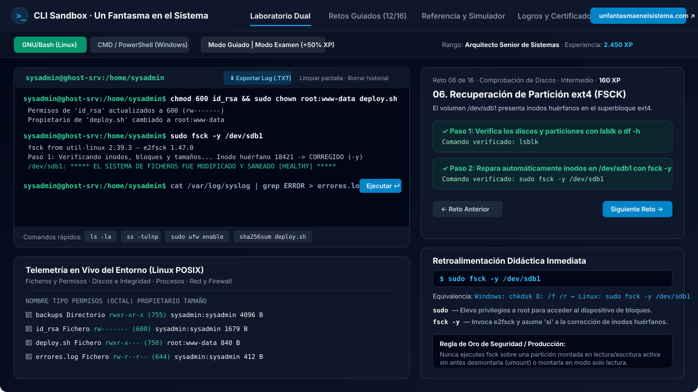
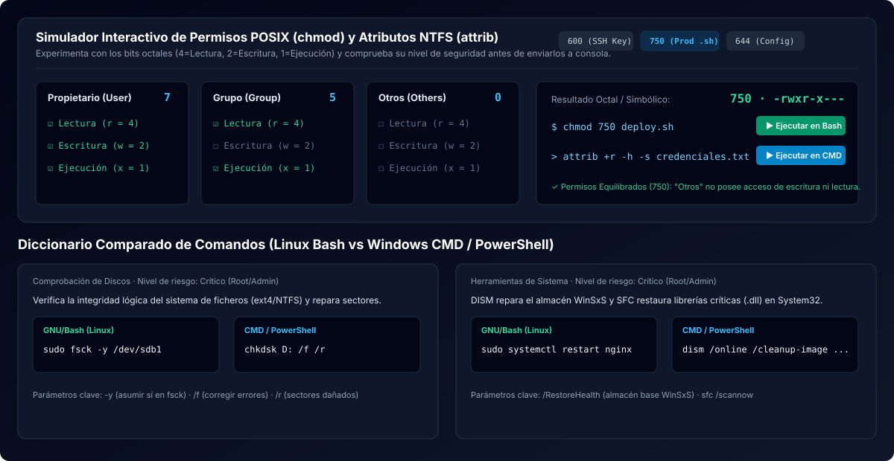
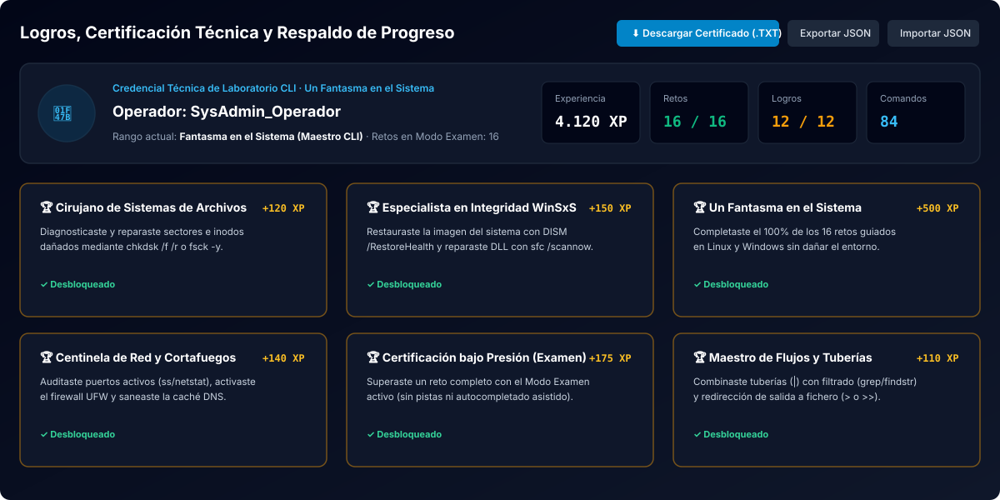

<div align="center">
  
  <h1>Entrenador de Línea de Comandos (CLI Sandbox)</h1>
  <p><strong>Emulador interactivo en JavaScript de consola dual (GNU/Bash y Windows CMD / PowerShell) para el aprendizaje práctico y seguro de administración de sistemas.</strong></p>
  <p>
    🌐 <a href="https://www.unfantasmaenelsistema.com/"><strong>https://www.unfantasmaenelsistema.com/</strong></a>
  </p>
</div>

---

## 📋 Descripción del Proyecto

**Entrenador de Línea de Comandos (CLI Sandbox)** es un laboratorio didáctico interactivo desarrollado en TypeScript y React que simula en el navegador tanto un servidor **Linux (GNU/Bash)** como un entorno **Windows Server (CMD y PowerShell)**.

Su objetivo es permitir a estudiantes y profesionales de administración de sistemas practicar operaciones críticas —como reparación de sistemas de archivos (`chkdsk`, `fsck`), mantenimiento de imagen del sistema (`dism`, `sfc /scannow`), endurecimiento de permisos (`chmod`, `chown`, `attrib`, `icacls`), finalización de procesos zombi (`kill -9`, `taskkill`, `Stop-Process`), auditoría de red (`ss -tulnp`, `netstat -ano`, `ufw`, `ipconfig /flushdns`), verificación criptográfica (`sha256sum`, `certutil`) y tuberías/redirecciones (`|`, `>`, `>>`)— **sin riesgo de dañar un sistema operativo real**.

---

## 📸 Capturas de Pantalla

### 1. Laboratorio Dual (Terminal Interactiva + Telemetría en Vivo + Retroalimentación Didáctica)


### 2. Simulador Interactivo de Permisos (`chmod` / `attrib`) y Diccionario Comparado


### 3. Sistema de Logros, Credencial Técnica y Respaldo de Sesión


---

## ✨ Características Principales

- 🖥️ **Consola Dual Realista (`GNU/Bash` y `Windows CMD / PowerShell`)**:
  - Sistema de Archivos Virtual (VFS) en memoria con soporte de permisos octales/simbólicos en Linux, propietarios (`root:www-data`), atributos NTFS (`R`, `H`, `S`, `A`) y listas de control de acceso (`ACL`) en Windows.
  - Navegación de historial con flechas `↑` / `↓`, autocompletado de ficheros con tecla `Tab` y páginas de manual integradas (`man <comando>` / `help`).
  - Soporte real de encadenamiento (`&&`), tuberías (`|`) con `grep` / `findstr` y redirecciones de flujo estándar a fichero (`>` sobrescribir y `>>` anexar).
- 🎯 **16 Retos Guiados Paso a Paso + Modo Examen (+50% XP)**:
  - Escenarios prácticos divididos en 6 áreas: *Gestión de Ficheros*, *Permisos y Criptografía SHA-256*, *Comprobación de Discos (`chkdsk`/`fsck`)*, *Herramientas de Sistema (`DISM`/`SFC`/`PowerShell`)*, *Redirecciones y Tuberías* y *Redes y Cortafuegos (`netstat`/`ss`/`ufw`)*.
  - **Modo Guiado**: incluye pistas explicativas e inserción rápida en consola.
  - **Modo Examen**: oculta ayudas para evaluar el dominio real del estudiante y otorga **+50% de experiencia (XP)**.
- 🧠 **Retroalimentación Didáctica Inmediata y Equivalencias Cruzadas**:
  - Cada comando ejecutado se analiza al instante mostrando su desglose sintáctico token por token, su **equivalente directo en el otro sistema operativo (Linux ↔ Windows)** y una **Regla de Oro de Seguridad en Producción**.
- 🔍 **Telemetría en Vivo del Sistema Virtual (4 Pestañas)**:
  - **Ficheros y Permisos**: Explorador interactivo del directorio actual con vista previa de contenido y cálculo rápido de hash SHA-256.
  - **Discos e Integridad**: Estado en vivo de volúmenes (`/dev/sda1`, `/dev/sdb1`, `C:`, `D:`) y salud de componentes Windows (`WinSxS DISM` y `System32 SFC`).
  - **Procesos**: Tabla en tiempo real de procesos en ejecución con consumo de CPU/RAM y detección de procesos intrusos.
  - **Red y Firewall**: Estado del cortafuegos `UFW` en Linux y de la caché de resolución DNS en Windows.
- 💾 **Persistencia en `localStorage` y Exportación de Log Profesional (`.TXT`)**:
  - La sesión completa de la terminal (historial de salidas, historial de comandos `↑`/`↓`, estado del VFS y progreso de retos/logros) se guarda automáticamente en `localStorage` para retomar el trabajo al recargar la página.
  - Botón **`Exportar Log (.TXT)`** en la terminal para descargar una traza completa de auditoría con todos los comandos ejecutados, sus salidas `STDOUT/STDERR` y los apuntes didácticos de repaso.
  - Exportación de **Certificado Técnico (`.TXT`)** y copia de seguridad completa en **`.JSON`**.

---

## 🛠️ Tabla Resumen de Comandos Soportados

| Categoría | GNU/Bash (Linux) | Windows CMD / PowerShell |
| :--- | :--- | :--- |
| **Navegación y Ficheros** | `pwd`, `ls -la`, `stat`, `cd`, `mkdir -p`, `touch`, `cp`, `mv`, `rm -rf`, `cat`, `head`, `tail`, `find` | `cd`, `dir /a`, `Get-ChildItem -Force`, `mkdir`, `copy`, `move`, `del`, `Remove-Item`, `type`, `Get-Content`, `tree` |
| **Permisos y Propietario** | `chmod <octal> <f>`, `sudo chown <u:g> <f>`, `id`, `whoami` | `attrib [+/-r/h/s] <f>`, `icacls <f> /grant Usuario:(F)`, `whoami` |
| **Comprobación de Discos** | `lsblk`, `df -h`, `sudo fsck -y /dev/sdb1` | `wmic logicaldisk`, `Get-Volume`, `chkdsk D: /f /r`, `Repair-Volume -DriveLetter D -SpotFix` |
| **Integridad del Sistema** | `sudo systemctl status/restart nginx`, `uname -a`, `free -h` | `dism /online /cleanup-image /restorehealth`, `sfc /scannow`, `systeminfo`, `ver` |
| **Gestión de Procesos** | `ps aux`, `top`, `sudo kill -9 <PID>` | `tasklist`, `Get-Process`, `taskkill /PID <id> /F`, `Stop-Process -Id <id> -Force` |
| **Redes y Cortafuegos** | `ss -tulnp`, `netstat -tulnp`, `ip a`, `ping`, `sudo ufw enable/status` | `netstat -ano`, `ipconfig /all`, `ipconfig /flushdns`, `ping` |
| **Criptografía e Historial** | `sha256sum <f>`, `md5sum <f>`, `history`, `history -c`, `man <cmd>` | `certutil -hashfile <f> SHA256`, `Get-FileHash <f>`, `history`, `Get-History`, `Clear-History` |
| **Tuberías y Redirección** | `cmd \| grep PATRON`, `cmd > archivo`, `cmd >> archivo` | `cmd \| findstr PATRON`, `cmd > archivo`, `cmd >> archivo` |

---

## 🚀 Instalación y Ejecución Local

1. **Clonar el repositorio:**
   ```bash
   git clone https://github.com/TU_USUARIO/cli-sandbox-entrenador.git
   cd cli-sandbox-entrenador
   ```

2. **Instalar dependencias:**
   ```bash
   npm install
   ```

3. **Iniciar el servidor de desarrollo:**
   ```bash
   npm run dev
   ```
   La aplicación estará disponible en `http://localhost:3000`.

4. **Generar versión de producción para despliegue estático:**
   ```bash
   npm run build
   ```
   Los archivos estáticos optimizados se generarán en la carpeta `dist/`.

---

## 🌐 Despliegue en GitHub Pages

El proyecto ya está preconfigurado para funcionar directamente en **GitHub Pages** desde cualquier subruta (`base: './'` en `vite.config.ts`) e incluye el flujo de trabajo automatizado en `.github/workflows/deploy.yml`:

1. Sube este repositorio a tu cuenta de GitHub (`main` o `master`).
2. En tu repositorio de GitHub, entra en **Settings → Pages**.
3. En la sección **Build and deployment → Source**, selecciona **GitHub Actions**.
4. Con cada `git push`, la acción compilará automáticamente el proyecto y lo publicará en tu URL de GitHub Pages.

---

## 👤 Autoría y Enlaces

Desarrollado para **Un Fantasma en el Sistema**:
- 🌐 Sitio web oficial: [https://www.unfantasmaenelsistema.com/](https://www.unfantasmaenelsistema.com/)
