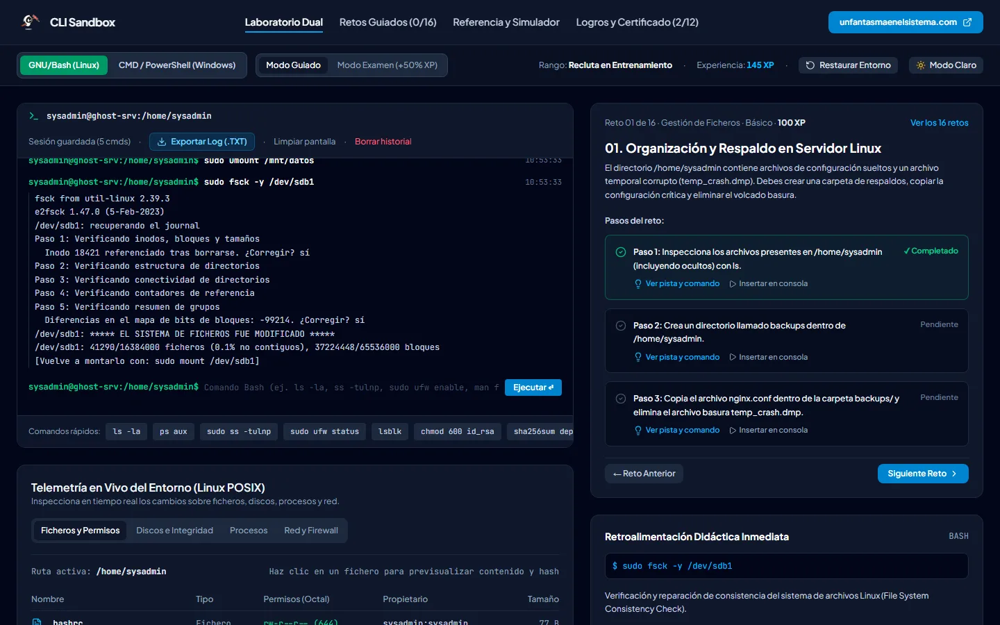
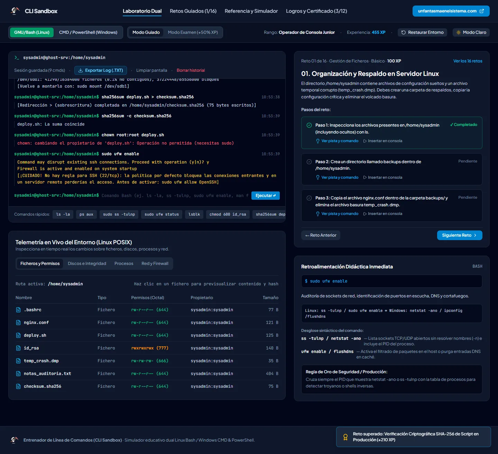
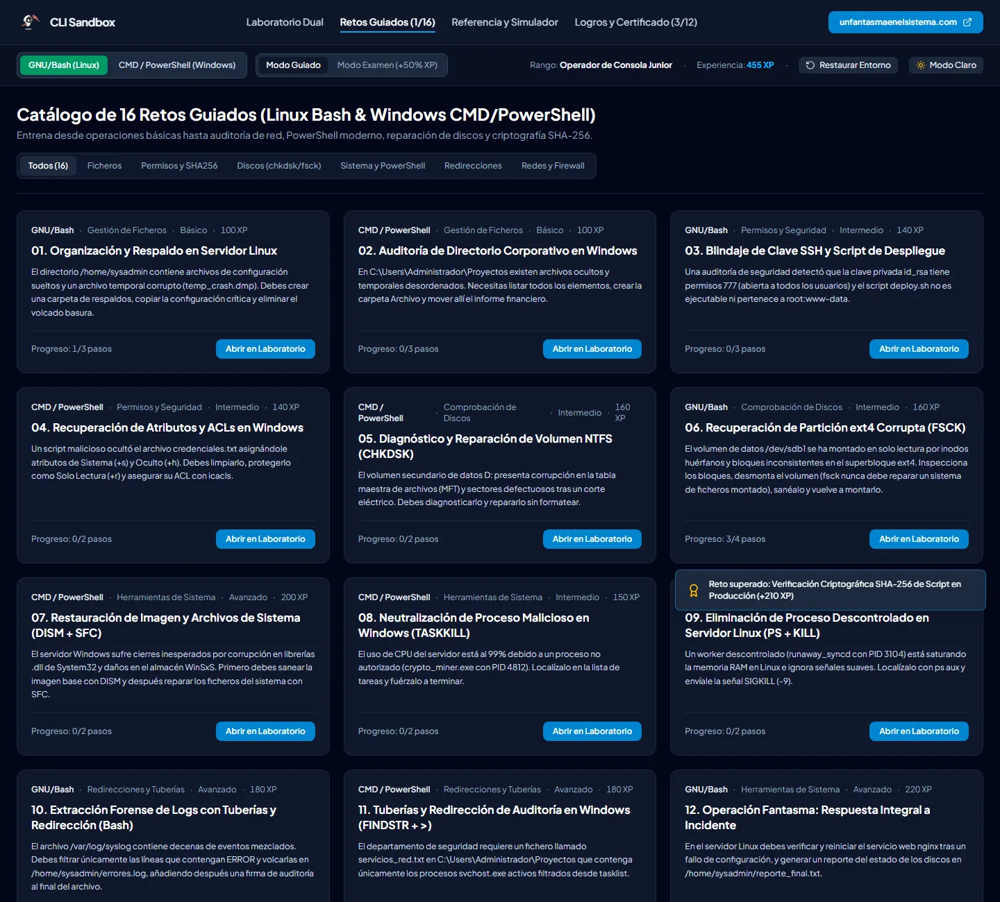
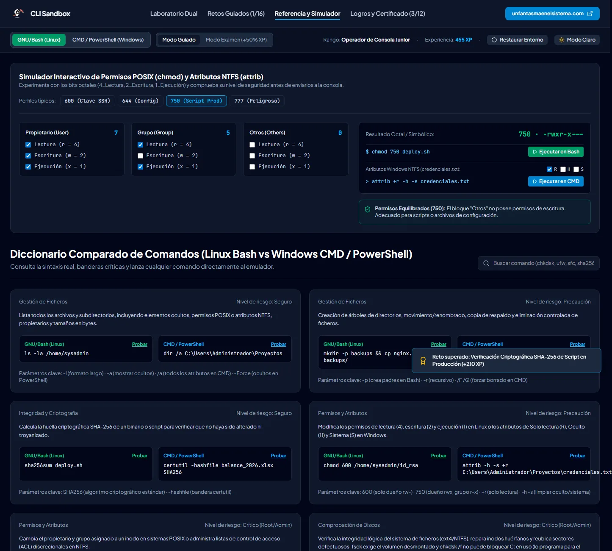

<p align="center">
  <a href="https://www.unfantasmaenelsistema.com"></a>
</p>

<h1 align="center">CLI Sandbox</h1>

<p align="center">
  <b>Entrenador de línea de comandos con una consola Bash y otra CMD/PowerShell en el navegador</b><br>
  Ficheros y permisos POSIX · Atributos y ACL de NTFS · fsck y chkdsk · DISM y SFC · Procesos · Tuberías y redirecciones · Red y cortafuegos · SHA-256 real
</p>

<p align="center">
  <a href="https://unfantasmaenelsistema.github.io/CLI-Sandbox/"><b>▶ Abrir el entrenador</b></a> ·
  <a href="#qué-hace">Qué hace</a> ·
  <a href="#retos">Retos</a> ·
  <a href="#qué-modela-y-qué-no">Qué modela</a> ·
  <a href="#desarrollo">Desarrollo</a> ·
  <a href="https://www.unfantasmaenelsistema.com">unfantasmaenelsistema.com</a> ·
  <a href="LICENSE">MIT</a>
</p>

<p align="center">
  
  
  
  
</p>

<p align="center">
  
</p>

Dos máquinas simuladas en el navegador, un servidor Ubuntu y un Windows Server 2025, con su sistema de ficheros, procesos, discos y red. Lo que escribes en la terminal cambia ese estado como en un sistema real: si quitas permisos, el fichero deja de poder leerse; si intentas reparar un volumen montado, `fsck` se niega; si activas el cortafuegos sin permitir SSH, te avisa de que te quedarías fuera. Nada de esto toca tu equipo.

> [!NOTE]
> Es un emulador didáctico, no una shell completa: implementa los comandos de los retos y sus opciones más habituales. Los hashes SHA-256 y MD5 sí son reales: coinciden con los de `sha256sum`, `md5sum`, `certutil` y `Get-FileHash` sobre el mismo contenido.

## Qué hace

- **Consola Bash** con sistema de ficheros virtual, usuario `sysadmin` (grupos `adm`, `sudo` y `www-data`) y permisos POSIX de verdad: lectura, escritura y borrado se comprueban con propietario, grupo y otros, y `sudo` es root.
- **Consola CMD/PowerShell** con atributos NTFS (`R`, `H`, `S`, `A`), ACL con `icacls` y cmdlets como `Get-ChildItem`, `Get-FileHash`, `Get-Volume`, `Repair-Volume`, `Get-Process` y `Stop-Process`.
- **Tuberías y redirecciones** (`|`, `>`, `>>`, `&&`) con `grep`, `findstr`, `Select-String`, `wc`, `head`, `tail` y `tee`.
- **Análisis didáctico de cada comando**: desglose token a token, equivalente en el otro sistema y una regla de seguridad en producción.
- **Telemetría en vivo** del sistema simulado: ficheros con sus permisos y hash, discos, procesos y red.
- **16 retos guiados** con pistas, **modo examen** (+50 % de experiencia), 12 logros, certificado y registro de la sesión exportables, y copia de seguridad en JSON.
- La sesión (terminal, historial, sistema de ficheros y progreso) se guarda en el propio navegador.

<p align="center">
  
</p>

## Retos

| Área | Bash | CMD / PowerShell |
| :-- | :-- | :-- |
| Ficheros | Respaldo en `backups/` y limpieza del volcado | Auditoría con `dir /a` y archivado |
| Permisos | `id_rsa` a 600, `deploy.sh` a 750 y `root:www-data` | Atributos de `credenciales.txt` y ACL con `icacls` |
| Discos | `lsblk`, `umount`, `fsck -y` y volver a montar | `chkdsk D:` y `chkdsk D: /f /r` |
| Sistema | `ps aux` y `kill -9` de un proceso descontrolado | DISM antes que SFC; `taskkill /F` de un minero |
| Redirecciones | `grep ERROR` del syslog a un informe | `tasklist \| findstr svchost` a un fichero |
| Redes | `ss -tulnp`, permitir SSH y activar UFW | `netstat -ano` e `ipconfig /flushdns` |
| PowerShell | — | `Get-Volume` y `Repair-Volume -SpotFix` |
| Integridad | `sha256sum` a un fichero y comprobación con `-c` | — |
| Final | Reinicio de nginx e informe con `df -h` | — |

Las pruebas automáticas del repositorio teclean el comando de ejemplo de cada paso de los 16 retos, en una misma sesión, y comprueban que todos quedan completados.

<p align="center">
  
</p>

## Qué modela y qué no

- `fsck` exige `sudo` y el volumen desmontado; la raíz no se puede desmontar en uso. `chkdsk C: /f` no repara al momento: se programa para el siguiente reinicio, como en Windows.
- `sfc /scannow` no consigue reparar mientras el almacén WinSxS esté dañado: primero `dism /restorehealth`.
- `kill` sin `-9` envía SIGTERM, que el proceso colgado ignora; `taskkill` sin `/F` tampoco cierra un proceso colgado.
- La redirección `>` la hace tu shell sin privilegios, así que `sudo echo x > /etc/f` falla igual que en Linux; para escribir como root se usa `| sudo tee`.
- `findstr` distingue mayúsculas salvo con `/i`; `Select-String` no las distingue salvo con `-CaseSensitive`.
- Los procesos críticos (`systemd`, `sshd`, `System`, `svchost`) están protegidos para que el ejercicio no termine con el servidor caído. La unidad `D:` solo existe para `chkdsk` y `Repair-Volume`.

<p align="center">
  
</p>

## Privacidad

Todo se ejecuta en el navegador, sin servidor ni cuentas. La sesión y el progreso se guardan en el almacenamiento local del navegador y se borran con los botones de la propia app. Las fuentes van incluidas en la web y una política CSP estricta impide cargar código o estilos de terceros.

## Desarrollo

Requisitos: Node.js 20 o superior.

```bash
git clone https://github.com/unfantasmaenelsistema/CLI-Sandbox.git
cd CLI-Sandbox
npm ci
npm run dev      # http://localhost:3000
npm test         # pruebas del motor (Vitest)
npm run lint     # comprobación de tipos
npm run build    # versión estática en dist/
```

El workflow `.github/workflows/deploy.yml` comprueba tipos, pasa las pruebas, compila y publica `dist/` en GitHub Pages en cada push a `main`.

```text
src/
├── engine/cliEngine.ts       # sistema simulado, comandos de Bash y CMD/PowerShell, análisis didáctico
├── engine/hash.ts            # SHA-256 y MD5 síncronos
├── engine/*.test.ts
├── data/challenges.ts        # los 16 retos y sus validaciones
├── data/referenceManual.ts   # referencia comparada y logros
└── components/               # simulador de permisos
```

## Cambios

### 2.0.0 (2026-11-01)

- Publicado en la organización con despliegue en GitHub Pages: el workflow original no podía funcionar (`npm install` fallaba por un conflicto de versiones de `esbuild` y la caché de npm no tenía lockfile). El código tampoco pasaba `tsc --noEmit`.
- **Hashes reales**: `sha256sum`, `md5sum`, `certutil` y `Get-FileHash` devolvían un hash inventado de 64 bits relleno con una cadena fija, que además dependía del nombre del fichero. Ahora son SHA-256 y MD5 auténticos del contenido; se añade `sha256sum -c` y un tercer paso de verificación al reto 16.
- **Permisos POSIX**: antes no se comprobaba nada (`chown` y `fsck` funcionaban sin `sudo`, `chmod 000` no impedía leer). Ahora lectura, escritura, borrado, `chmod`, `chown`, `kill`, `systemctl`, `ufw`, `mount` y `fsck` respetan propietario, grupo y root.
- **Discos**: `fsck` exige el volumen desmontado (nuevos `mount` y `umount`; el reto 6 pasa a 4 pasos). `chkdsk C: /f` se programa para el reinicio.
- **Ficheros**: `mv` de una carpeta la convertía en un fichero vacío; `touch` añadía un salto de línea; `mv` a una ruta inexistente borraba el original; `cp` y `rm` de carpetas no pedían `-r`; `mkdir` creaba padres sin `-p`. En Windows, `move` también destruía carpetas y `del` las borraba enteras (nuevo `rmdir /s`).
- **Filtros**: `grep` activaba `-i` con cualquier patrón que llevara una «i»; `wc` ignoraba el fichero; `head`/`tail` no aceptaban `-n` y daban 5 líneas en vez de 10; `find` ignoraba sus opciones; `findstr` no distinguía mayúsculas. Se añaden `tee`, `grep -v/-n/-c` y `chmod` simbólico completo.
- **Sistema y red**: `kill` sin `-9`, `taskkill` sin `/F` y SFC antes de DISM se comportan como en la realidad; `ss -l` solo muestra lo que escucha; UFW admite reglas y avisa si se activa sin permitir SSH (el reto 14 añade ese paso).
- **Textos**: el reto 9 hablaba de un proceso «zombi» que no lo era (a un zombi no se le puede matar con `kill -9`); `/var/log/syslog` solo se puede leer porque `sysadmin` está en el grupo `adm`, que faltaba en `id`.
- **Interfaz**: la cabecera desbordaba a 1.000 px y en el móvil. Fuentes incluidas en la web en lugar de Google Fonts, CSP estricta, fuera dependencias de Gemini y Express que no se usaban, y 28 pruebas automáticas.

### 1.0.0

- Versión inicial generada con Google AI Studio.

## Créditos y licencia

Creado por **[Un Fantasma en el Sistema](https://www.unfantasmaenelsistema.com)** para los módulos de sistemas operativos y administración de sistemas de FP. Fuentes Plus Jakarta Sans y JetBrains Mono (SIL Open Font License) vía Fontsource; iconos de Lucide (ISC).

Código bajo licencia [MIT](LICENSE).
